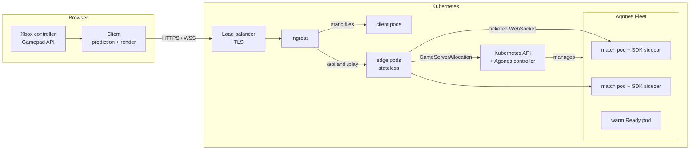
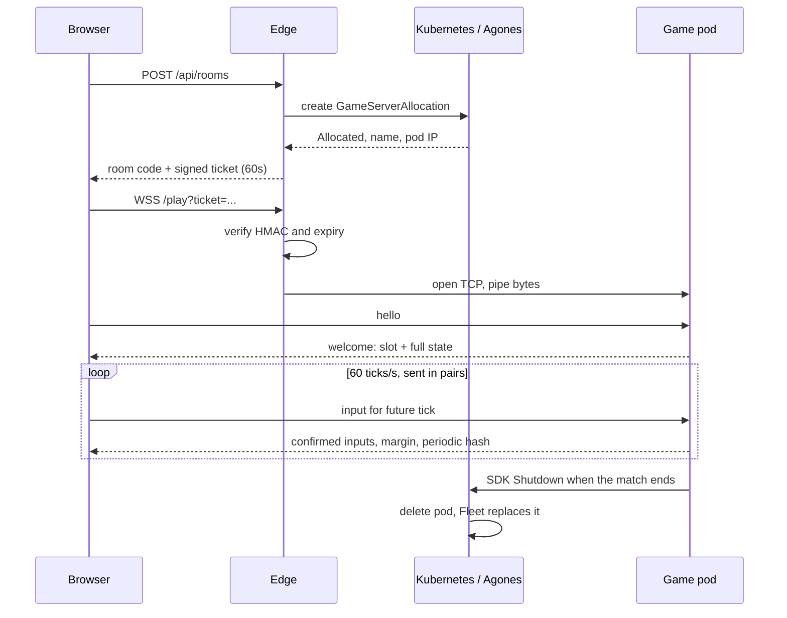

# Architecture

## The decisions that shape everything

| Decision | Choice | Why |
|---|---|---|
| Who owns the truth | A dedicated server | Hosts can't cheat, and a player leaving doesn't end the match |
| How clients stay in sync | Everyone runs the same deterministic sim from server-ordered inputs | Tiny bandwidth: inputs, not world state |
| How it feels responsive | Client predicts its own inputs and replays when the server answers | Punches land on the frame you press |
| One process per match | Agones GameServer | A crash or deploy affects one match, and scaling is just pod count |
| Browser transport | WebSocket through a TLS gateway | Works everywhere today, behind one small `Transport` seam |

## Runtime

## Joining a match

A friend joins with `POST /api/rooms/<code>/join`. The code is the GameServer name, so any edge replica can resolve it from the Kubernetes API, and the edge keeps no state.

## Why the browser path goes through a gateway

Agones normally hands clients a node IP and port. That doesn't work for an HTTPS page: it may only open `wss://`, and a certificate can't practically cover every node's address. So TLS ends at the load balancer and the edge forwards the socket to the pod.

The ticket is what makes this safe. The destination comes only from an HMAC-signed ticket, because a proxy that took its destination from the client would be an open door into the cluster network. A NetworkPolicy then limits game pods to traffic from the edge.

The cost is one extra hop inside the cluster. To remove it later, give each node a DNS name under a wildcard certificate and connect straight to the host port.

## Netcode

Each client holds two copies of the world:

- `confirmed` advances only with inputs ordered by the server, so it is identical everywhere.
- `predicted` is `confirmed` plus this player's unacknowledged inputs. It is what gets drawn. Remote players are assumed to keep holding their last confirmed input.

When confirmed inputs arrive, the client discards the prediction and replays from `confirmed`. Replaying a few ticks with a handful of fighters is cheap, so there is no snapshot ring to manage.

| Situation | What happens |
|---|---|
| Input arrives late | The server reuses the last input, and the client's next replay corrects it |
| Client clock drifts | The server reports `margin`, and the client runs up to 4% faster or slower |
| Server goes quiet | Prediction stops at 30 ticks instead of drifting further |
| Desync | Hashes are compared every 60 ticks, and a mismatch requests a fresh snapshot |
| Late join | The newcomer receives a full snapshot |
| Malicious input | Unknown bits are masked, far-future ticks dropped, message size capped at 1 KB |

Effects need care under replay: one hit can show up in several replays, so sparks and rumble fire once per tick, attacker and target.

## Transport

WebSocket runs on TCP, so one lost packet delays everything behind it. On a bad connection that shows as a brief freeze.

WebTransport datagrams avoid this, and WebTransport became Baseline in March 2026. It isn't the default here because Node has no built-in server for it, and it needs HTTP/3 through the whole path, including the load balancer. Treat it as a later upgrade, with the game server or a small gateway in Go or Rust.

## Scaling

| Part | Scales by | State |
|---|---|---|
| Client | Replicas or a CDN | None |
| Edge | HorizontalPodAutoscaler on CPU | None |
| Game | FleetAutoscaler keeping a buffer of Ready pods | One match in memory |

Game pods set CPU requests equal to limits, because CPU throttling on a 60Hz loop is a visible stutter. Node upgrades need planning, because draining a node ends any match on it. Edge restarts drop sockets, so reconnect support is on the [roadmap](ROADMAP.md).
